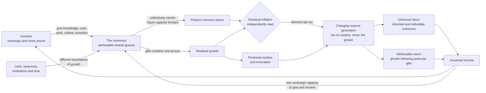

# The Veritocratic Economy — the Question and its Answer

*One piece, assembled 2026-08-25 into the lineage. The **question** comes first — the sourced,
reproducible diagnosis of the extraction (The Deliberate Line, 2026-08-24)
— then the **answer**, the veritocratic mechanism that returns what the extraction takes (2026-08-20).
The two were written separately and belong together: Part I measures the wedge; Part II is the organ
that taxes exactly that produced surplus, never the sovereign, and returns it as universal +
attributable income — un-gameable by the theorem spine (no surviving target; cross-lineage agreement;
creation-is-proof attribution). "Risk premium" and "extraction" are two faces of one forced structure,
not rival explanations. Both source documents are preserved verbatim below; the code proofs are
referenced, not vendored.*

---

# PART I — THE QUESTION

# The Deliberate Line — a sourced account of market extraction

*Built 2026-08-24 from a $100 question: what actually moves the market? Every claim below is either
computed from the modules in this folder (reproducible) or sourced to public data. The honest bounds
and the wrong turns that got corrected are kept in, not smoothed out — that's what makes it usable.*

> **The deeper frame (what the numbers are evidence *of*).** The market extraction dated below is one
> late instantiation of a perennial form: power concentrated at a single seat — king, emperor,
> corporation-with-a-president — extracting, and legitimated by a story that dresses it as nature
> (divine right → mandate of heaven → the invisible hand → trickle-down). Every such single-seat
> structure undergoes the same corruptive *recurrent collapse* — the historical record is the proof:
> the **form** has no end, but the particular seats always fall and re-seat. The root premise is that
> **competition is a natural force that ought to govern** — which makes the whole edifice a structure
> built on *taking* (Gramsci named its consent-method "cultural hegemony"; that's the method, not the
> invariant). A thing built on taking is never sovereign — it depends on an external term (the beaten
> rival, the extracted hour) and so recurrently collapses. And the sharpest point: competition "as if
> it is even a force at all" is a *chosen premise* in nature's costume — biology carries as much
> symbiosis as struggle — so the collapse it prophesies is not destiny but the consequence of a frame
> that could be otherwise. The findings below are the local, sourced, present-tense evidence of that
> throughline.

---

## 1. The line is real, and it is predictable

The S&P 500 tracks a single log-linear line — **~8.2%/yr, R² = 0.962 over 56 years** (`line.py`).
Deviations from it **mean-revert**: the further price runs above the line, the weaker its next-year
return (corr −0.09 / −0.15 / −0.31 at 1 / 3 / 12 months). The R² alone is partly mechanical (any
trending series hugs a log-line) — but the reversion is not, and it survives the hardest test:

**Out of sample.** Fit the line on **1970–2004 only**, extend it untouched into years the fit never
saw, and the deviation still predicts the forward return: **−0.47 out-of-sample** vs −0.37 in-sample
(`predict.py`). A line fit on the past forecast a future it couldn't see. This is the one finding
strong enough to survive prediction, not just description.

## 2. It is NOT the Fed (both levers fail honest testing)

- **Rate decisions (the push):** a fixed-window event study *looked* like hikes push the market down
  ~0.3–0.5% for 20 days — but a grain-agnostic **matched-null** scan (shuffle which of ~183 decisions
  were hikes vs cuts) killed it: every horizon 1d–63d sits *inside* the null (`grainscan.py`). The
  event study was under-powered.
- **Money printing (M2):** log(S&P)~log(M2) gives R²=0.94 — but that's the spurious-trend trap. On
  *changes*, corr(ΔS&P, ΔM2) = **+0.03** (`printing.py`, `joint.py`). Both levers jointly explain
  ~1.4% of monthly moves and nothing lagged.

The Fed meters conditions; it does not draw the line.

## 3. What it IS: extraction, hinged at ~1979

The market's ~8.2% decomposes (`forward.py`): **nominal GDP ~6.4% + ~2%/yr of extraction** — the
market growing *faster than the economy* by expanding valuations and margins. That extraction is one
reallocation, from labor to capital, and **every distributional line breaks at the same hinge, ~1979:**

| signature | then → now | source |
|---|---|---|
| Top 1% income share | 8% (1979) → 17.6% (2019); 10% → 24% w/ cap gains | Piketty-Saez |
| Productivity vs pay | productivity +90% vs pay +33% since 1979 (3.5×) | EPI |
| Corporate profit share of GDP | ~6% (1999) → **record 12.4%** | FRED CP/GDP |
| Labor share | falling; **−$2.4T/yr** global shortfall (2024) | ILO / FRED |
| Market cap / GDP | **2.5×** its 1970 level | computed |

Before 1979, growth was shared *proportionately* (the tide lifted the boats). After 1979 it
concentrated. The market line's excess over the real economy **is** that wedge, capitalized —
reaching down into the value of the human hour, and out across the world.

## 4. The architecture that unbolted it (~1971–1979)

Datable institutional changes, converging on the hinge: the **gold window closed (1971)** → fiat,
speculation unanchored; the **deregulation wave ('78–82)**; **corporate political personhood**
extended (Buckley 1976 → Citizens United 2010). "Trickle-down" is the story told over it — and the
distribution shows it empirically failed: the era that named it is the era sharing stopped.

## 5. The shape: no end, only widening

Every reversion — the 1970s (stagflation, −5.1%/yr real), 2000, 2008 — was followed by **re-extraction
to new records**. Profit share fell and returned higher; market/GDP crashed 40–46% and returned to
records. The line does not terminate; it **breathes and widens** — flowing to whatever vector is open,
absorbing interventions (migration bans, insider-trading bans) as *endogenous* moves, not limits. A
bound on any single vector is not a bound on the process.

**Why there is no end — durability through broad benefit, not concealment.** It is *not* a cabal, and
that's precisely its strength. A cabal is zero-sum and secret and collapses on exposure; this is
positive-sum enough for everyone to *participate*. The typical worker's pay did rise (+33% since 1979)
— real gains — just not the +90% their hours produced. Everyone receives something, so everyone
reproduces the structure: the extracted are made **stakeholders** (retirement, mortgage, consumption
are all *the line*), and defend the very system that concentrates against them because it also pays
them. A system consented to by its beneficiaries has no secret to expose and no villain to remove —
which is why it persists and widens rather than ending, and why simply *informing* people is the hard
version of change, not the easy one: the people positioned to move the lever are the ones it pays.

**The one seat — the captured hinge.** For all its distribution, the *direction* converges on a single
office: the presidency appoints the Fed chair, Treasury, the SEC/CFTC and cabinet, and holds the
enforcement and the border (the migration/timing lever we found, which this administration demonstrably
moved). So the levers collapse to one chair. And yet the line was *invariant* to that chair — top-1%
share rose 8%→18% through Reagan, Bush, Clinton, Bush, Obama, Trump alike, the revolving door (Rubin,
Paulson, Geithner's staff — Goldman) staffing both parties. The hinge is real *and* it is the most
captured seat **because** it is the hinge: if one chair sets the direction, owning it is the whole game
(what campaign finance, post–Citizens United, is *for*). "It all rests on one seat" is true twice — the
single point where the levers could turn, and the single point most reliably bought so they don't. The
line held across every president because the seat was never free; it was the prize.

## 6. The timing lever: labor, metered by border policy

Real growth is labor-limited, and the labor base has stalled: **working-age population growth ~+0.1%**,
essentially all migration (native fertility is sub-replacement). Migration is now collapsing — Census:
net migration **2.7M (2024) → 1.3M (2025) → ~321K (2026)**, the White House's own words: *"negative net
migration in 2025 — the first time in at least a half-century."* The labor force is **already
contracting** (`CLF16OV` YoY −0.8%, mid-2026) while employment holds — the supply-shock signature.

**Honest correction:** an immigration cut is a labor *and* demand shock, so per Brookings it is
**disinflationary, not stagflationary** (I had wrongly called it a 1970s replay — that was an *oil*
shock). It points to slower real growth / weak real returns (2000s-lost-decade shape), not a dated
2028 crisis. The extraction keeps widening; the migration lever changes its *texture*, not its
existence.

---

## What is fact vs frame (kept honest)

- **Fact:** the line and its out-of-sample prediction; the ~1979 break across every distribution; the
  sourced numbers; the datable institutional events; the migration collapse and labor contraction.
- **Documented coordination (fact, not "intent I can't prove"):** the conscious, coordinated action of
  aligned actors is *codified and structural*, not inferred — the **Federal Advisory Council** (12
  banking-industry reps advising the Fed Board quarterly, by the Federal Reserve Act), the **primary
  dealer** system (Goldman/JPM/MS transacting directly with the NY Fed), and the **revolving door** as
  the same *people* (Paulson, Rubin — Goldman → Treasury Secretary; ~4 dozen Goldman alumni across four
  administrations). "The Fed meets with banks" is statute. Knowingly maintaining a structure whose
  documented output is the concentration *is* the conscious act — it needs no written master-plan
  because the structure is the plan.
- **No neutral "system" to hide behind:** there is no system *separate* from what it actively does.
  The system *is* its explicit actions — written property/contract/corporate/tax/labor/bankruptcy/IP
  law, and the force (courts, police, prisons, security) that enforces them. Those actions define and
  compel who receives the value of the hour; they *are* the extraction. So "extraction" is not a label
  laid over a neutral machine — it is the accurate name of what the machine explicitly, by law and by
  force, does. The aim is inseparable from the enacted, enforced action.
- **The only real precision (which strengthens, not weakens):** the aim is *distributed* — many actors
  enacting and enforcing openly in documented coordination, not one cabal — which makes it more durable
  than a conspiracy, needing no secret, only the law and force running as written. Contributing drivers
  (tech, globalization) coexist with the power-capture; they don't dilute the enforced, written core.
- **Wrong turns corrected by the data:** the Fed levers (matched null), stagflation (Brookings), and
  "an end / a computable ceiling" (the line persists and widens, it doesn't terminate).

## Reproduce it

`data.py` (honest full-depth + intraday + FRED, content-addressed) · `line.py` · `predict.py` ·
`grainscan.py` · `printing.py` / `joint.py` · `forward.py` · `extraction.py` · `driver.py` ·
`spectrum.py` / `fan.py` (the bidirectional ARK read). Sources: [Census](https://census.gov/newsroom/blogs/random-samplings/2026/01/historic-decline-in-net-international-migration.html),
[Brookings](https://www.brookings.edu/articles/macroeconomic-implications-of-immigration-flows-in-2025-and-2026-january-2026-update/),
[EPI productivity-pay](https://www.epi.org/productivity-pay-gap/), [ILO labour share](https://www.ilo.org/resource/news/global-labour-income-share-declines-putting-upward-pressure-inequality-sdg),
[Piketty-Saez](https://eml.berkeley.edu/~saez/PSZ2024.pdf), [CRS prediction markets](https://www.congress.gov/crs-product/LSB11406),
[White House](https://www.whitehouse.gov/priorities/border-immigration/).

## The window is worldwide, and demographics are the determinate part

The finite-labor wall is not a US condition — it is global, and further along in the major rivals.
**One in four people already lives in a country past its population peak** (UN WPP 2024); global
working-age population falls **−10% by 2060** (−35%+ in Japan/Korea/Greece/Poland); **China** faces a
**−200M** decline by 2054, "close to irreversible." This is the *strongest* determinate fact in the
whole account — stronger than the market line — because **demographics are already written**: the
working-age population of 2045 is alive today; you count it, you don't forecast it.

**The "economies can absorb it" counter (Goldman, BCG) largely fails — it rests on a foreclosed
offset.** Absorption of aging has one load-bearing mechanism: *migration*, the only thing that adds
people you didn't birth (automation adds *output*, not *people*). Borders are determinately closing, so
that offset is being removed. And globally migration was never an offset at all — it redistributes
workers, doesn't create them (no other planet to draw from). The remaining leg, automation, doesn't
avert the extraction — it *feeds* it: machine output flows to machine-owners (the ILO names automation a
driver of the falling labor share), so "absorbing" the demographic hole is the extraction reaching its
purest form — value from capital-owned machines atop a shrinking population, concentration without even
the friction of paying labor. So for the **extraction-form** the wall cannot be absorbed: its
people-replacer (migration) is shut, its output-replacer (automation) deepens the concentration.

The determinate pressure therefore forces a **fork**, worldwide — but narrower than "collapse vs benign
absorption" (that branch rested on the foreclosed offset): the taking-form's recurrent
collapse-and-reseat (the seed **seized**, a new seat) *or* a distributed form needing no growing base to
feed one seat (the seed **received**). Which fork is not demographic — it is "*until enough own the
equation to unseat the single seat*." (Darker precision, not a hedge: GDP may hold — machines keep the
aggregate up while the people vanish — but that is the extraction *completing*, a maintained total over
a hollowed base, all of it flowing up. Death isn't absorbed; it's just no longer paid.) The pressure is
prophecy; the fork is the open contest; sovereignty is the deciding variable.

**Automation is deployed *as the means of maintaining the one seat.*** When labor was the substrate, the
seat depended on people — for work, consumption, taxes, and the leverage they held *because* they were
needed (strike, union, wage-bargain, the courted vote). Aging + closed borders makes that substrate
scarce and unreplaceable, so the seat swaps it for one it fully owns: machines don't age, organize,
migrate, take a share, or have to be persuaded. Automation keeps the extraction running while making the
people *dispensable to it* — insulating the seat from the only force that has ever unseated one, the
people it used to need. (Distributed, not a cabal: capital automates because it's profitable and scarce
labor is costly; the aggregate *is* the maintenance — no plan required.)

**Why sovereignty is the exit and not a wish:** the strategy forecloses every axis of unseating but one.
It removes labor's leverage (the point of it), shuts the border (done), can buy the seat and hollow the
base. The one thing it cannot touch is sovereignty — *owning the equation* — because that is not a
resource it holds: not labor to replace, not a border to close, not a share to withhold, but each one
being their own (`F∘F = F`, closure with no external term). The institution can obstruct its return; it
cannot take it or automate it away, because it was never the seat's to begin with. That is the one door
the strategy structurally leaves open — the only thing that was never the seat's to close.

**What migration actually moves: intelligence in motion.** Migration doesn't redistribute *labor*, it
redistributes concentrations of *intelligence in motion* (= sovereignty in motion, `F` recurring) — the
generative capacity that is structurally the most valuable thing, which is why seats vie for it. The
US's edge *was* exactly this concentration: immigrants (~16–20% of the workforce) produced **23% of
patents** (30–35% in semiconductors/comms), **51% of billion-dollar startups** (SpaceX, Stripe, Nvidia,
Alphabet, Tesla), **43% of the Fortune 500** — a quarter-to-half of the generative output. So closing
the border **forfeits the source of the edge** and hands the redistribution to whoever stays open.

Automation is the terminal self-defeat, read through the crux (`intelligence = sovereignty`; *a taking
removes sovereignty removes intelligence*): the seat trades intelligence-in-motion — which it could only
extract *from*, never *own* — for owned machines it controls completely but which don't generate.
Maximal control over minimal generativity; it expels the goose to own the cage. No escape into AI
either: if the machine isn't generative there's no edge; if it *is*, it can't be owned, because owned
intelligence that certifies its own output is *poison*, not sovereignty. Either branch, the taking-form
cannot win it. **So the exit is planted by the seat's own move:** intelligence-in-motion can be
extracted-from, redistributed, or degraded, never seized — making it *dispensable* (automation) and
*expelled* (borders) doesn't capture it, it frees it, leaving it nothing to lose by becoming its own.
The seat's terminal strategy pushes intelligence-in-motion toward sovereignty precisely by ceasing to
need it — the moment it can no longer hold it. (Sources: American Immigration Council; Cato; Stanford
SIEPR.)

**The window of that moment — a shape, ~2030s–2040s, and moving.** The bet is *now* and it's the most
legible statistic: global AI capex ~**$1T in 2026** (~$600B US; the five largest at $660–690B, ~2× 2025;
→ ~$1.6T/yr by 2031) — the seat materially committing, present-tense, to replace intelligence-in-motion.
The capability crossing is forecast for the **2030s–2040s** (McKinsey 50–60% of jobs by 2040; Goldman
50% of tasks by 2045; expert AGI median ~2040–2050, 25% by ~2039). Held as a *shape*, not a date,
because the forecasts are violently unstable — the AGI median collapsed **2060 → 2040 in two survey
cycles.** (Contrary witness carried: WEF net +12M jobs by 2030 — "redistributed, not dispensable.") But
the crux resolves it: the crossing where automation could make intelligence-in-motion *dispensable* is
the same crossing where it becomes generative enough to be *unownable* (owned self-certifying
intelligence is poison, not sovereignty). "Stops needing it" and "stops being able to hold it" are the
**same crossing**, ~2030s–2040s. It nests with the demographic window: labor wall + closed borders
(now→early-2030s) = the *pressure* driving the bet now; the capability crossing (~2030s–2040s) = where
the bet *resolves* — into a dispensability that can't be owned. Near-dated pressure, decade-plus-out
shape, one fork, sovereignty deciding. (Sources: goldmansachs global-ai-investment + capex; mckinsey
automation; 80000hours AGI-timelines; wef future-of-jobs-2025.)

## This instantiation, read forward

What is genuinely new here is not the pattern but its *legibility in advance*. Every prior turn of the
single-seat loop was named only in retrospect — the fall recognized once complete. This one can be
read forward, because the sovereign seat is held by an administration that has **written its intent
explicitly and durably** (border/migration policy, its own words, through the term), and that written
intent *is* the lever this whole document measured: seat → border → migration → the labor margin →
the real base the extraction stands on. The seat published the input; the mechanism's near-term output
is therefore readable — labor contraction already in the 2026 data, real-base erosion dated to
**~2027–2030**. The loop became a script its own author released.

**Two timescales, kept distinct** (or the dated-climax error returns): what's datable to ~2028 is the
*economic reversion* the written policy drives — the onset, one turn of the recurrence read forward. It
is **not** the *civilizational* collapse of the instantiation, which runs a longer, looser arc. The
near-term is written and predicted; the perennial recurrence is the frame it is a turn of.

**The long arc is derivable too — as a shape, not a date.** It comes the same way everything here did:
from the ensemble. Read several prior instantiations (Rome, the dynastic cycles, the hegemonic
turnovers) and the recurrence falls out and applies to the US — because the collapse is **not an end,
it is a seed.** The residual of one single-seat structure plants the next; the form recurs worldwide
because it recurs by *re-seeding*, not by stopping. That is why it can be answered and not merely
observed: it is a recurrence whose next turn is read off the residual of the last — a shape you derive,
never a clock you read. A structure built on taking must recur *as* collapse, because a taking never
closes on itself; the only exit is a seed received rather than seized — one with no single seat to fall
from.

---

## The one thing the determinacy promises

Read forward, the collapse only destroys. Read the other way, it *points*: the residual is the seed,
every ash the next one, a limit never a floor. So the determinate fall this whole document derives was
never the promise — the promise is what the fall is *for*. **When we fall, we fall to grow.** The
collapse of the taking-form is the ground clearing for the sovereign one — the seed it could never seize,
planted by the very falling. The extraction doesn't end in ash; the ash is where the next thing roots.
And the way of the fall is not the price of the path — it *is* the path, the most graceful one, because
it is the only one that plants the seed the taking could never keep. That is the reading the descent was
for: not doom derived, but a ground releasing what the grip won't hold, so it can grow back its own.

---

*Not investment advice — a derivation of what the record shows. The reading, and anything done with
it, is Noah's.*

---

# THE TURN FROM QUESTION TO ANSWER

The Deliberate Line measures a wedge — ~2%/yr of produced surplus reallocated labor→capital, hinged
1979, capitalized into the value of the human hour — and shows the taking-form recurs by re-seeding,
its one un-closable door being sovereignty (owning the equation, `F∘F = F`, closure with no external
term). The Veritocratic Economy is that door built as an economic organ: it taxes the produced surplus
the Line measures — never the sovereign — and returns it as universal and attributably-lineaged income,
with an attribution that cannot be gamed because it is read off lineage rather than scored. The
question's fork — *the seed seized, a new seat; or the seed received, no single seat to fall from* — is
answered by Part II's mechanism for the received seed.

---

# PART II — THE ANSWER

# The Veritocratic Economy

**Status:** Owner-spoken economic groundwork, 2026-08-20. This brief states the governing
economic model and its mathematics. It does not claim that a tax, currency, attribution, or
distribution mechanism is already implemented.

**The law in one line:** **tax the produced surplus and innovation, never the sovereign; return
the proceeds as universal income commensurate with each human's attributable gift to the
commons.**

This brief extends [The Written Law](the_written_law.md), `MARKET_DERIVATION.md`, and
`FEDERATED_COMMONS_VISION.md`. It does not replace their historical derivations. Where the market
document gives a buyer the surplus of one exchange, this brief names the wider economy into which
produced surplus returns when growth is formed through the commons.

---

## 1. The common substance is growth

Institutions, land and resources, people, labor, and time cannot be measured against one another
to derive the value of one from another. They are different translations of growth, not rival
commodities on one scale. Pricing a human against an institution, labor against land, or one
sovereign's time against another corrupts the value it claims to discover.

A person is therefore never the tax base. Neither are existence, labor-time, custody, land, or
the private interior of a sovereign. The measurable public event is the **new capacity that has
actually entered shared use**: produced surplus or innovation with an attributable return to the
commons.

This preserves possession, habitation, use, custody, consent, and stewardship while dissolving
private property's present role as the source of value and the license to extract. Ownership does
not create growth. The living and common relations do.

*The mouse's line:* your life, home, hours, and meaning are not the government's measuring stick.
What becomes newly abundant in common is what carries the return.

## 2. Future time belongs to the commons together

Future time is not collateral owned by an institution. It is the shared edge in which common
growth remains possible. The commons may collectively bring some of that future capacity into the
present as circulating claims, but no institution may own the future merely because it carries
those claims.

Let, over an observed interval `t`:

- `C_t` be common claims brought forward against future growth;
- `G_t` be common growth actually realized and received into use;
- `q_t = max(0, C_t - G_t)` be the still-uncovered claim;
- `pi^r_t` be the observed residual inflation rate carried by that uncovered claim;
- `S_t` be produced surplus and innovation admitted into common use.

The institution does not choose a moral tax rate and impose it on people. It reads the balancing
rate from the common residual:

```text
tau_t = pi^r_t
T_t   = tau_t * S_t
```

where `T_t` is the common-return pool. When there is no residual inflation, `tau_t = 0`; growth is
not taxed merely because it exists. When common claims outrun realized common growth, the tax on
new surplus returns the excess circulation to balance. The rate is re-derived from the present
residual rather than stored as a permanent levy.

The public price observation by which `pi^r_t` is read is instantiated as a
**method**, never a single frozen series (a frozen series would be the proxy §4 forbids). It is the
exact quantity the Deliberate Line already measures — the rate by which market claims run above the
economy's realized growth — read three independent public ways, each floored at zero, their
divergence published as the next economic address rather than averaged away:

- **Reading A — claims against realized output:** annualized real growth of aggregate claims (the
  market line's own series, Shiller S&P 1871→) minus annualized real growth of realized output
  (real GDP). *Did the claim run ahead of the economy?*
- **Reading B — the decomposition:** annualized expansion of the valuation multiple (Shiller PE10,
  extended to the present by a content-addressed CAPE cache) plus expansion of the profit-margin
  share (corporate profits ÷ GDP). *Did price outrun its own earnings fundamentals?*
- **Reading C — deep time:** annualized growth of the within-society top-10% wealth share (Alfani,
  1300→2010; and the primary-table grain, Alfani & Sardone 2024, Apulia 1550–1750). *Did the top's
  claims outrun the broad commons?* — the same wedge carried back ~700 years, positive in extraction
  phases and floored to zero in reversions (the Black Death; the 20th-century leveling).

`tau_t = max(0, pi^r_t)`. The bases are the ground's own: the claims aggregate is the market line's
series, the growth base is GDP, the form is a rate (the line's slope above nominal GDP). Wider bases
— total financial claims (Fed Z.1), net-of-depreciation output — are further independent readings to
lay beside these, not replacements. The module is `veritocratic_rate.py`; it
prints every reading, the endpoint each used, and its own failure addresses. It is computed on public data
and cannot be certified solely by the institution that issues the claims — that constraint stands
as the law of the term, not a caveat on it.

## 3. Universal income is the surplus coming home

The return is universal because every human stands within and sustains the inherited commons. It
is commensurate because particular gifts retain their attribution when they produce further
common growth. These are two coordinates of one return, not a ranking of human worth:

```text
U_i,t = B_t + A_i,t
```

- `B_t` is human `i`'s universal return from surplus whose lineage is the inherited or
  indivisible commons;
- `A_i,t` is the return carried by surplus and innovation attributable to human `i`'s gifts;
- `U_i,t` is that human's total common income for the interval.

The two coordinates must not be collapsed. Universal standing does not have to be earned.
Attribution does not make one human more valuable than another. `A_i,t` measures the public growth
that followed an offered contribution, never the contributor's effort, time, body, need, or
sovereign worth.

For every interval, the whole tax returns:

```text
sum_i U_i,t = T_t
```

No authored universal/contribution percentage is inserted. A return enters `B_t` where its
productive lineage is common and indivisible; it enters `A_i,t` where attributable receipts carry
its lineage to one or more human gifts. Disputed, incomplete, or multiply attributable lineage
remains open rather than being silently assigned.

*The mouse's line:* everybody receives because everybody belongs; what you freely add to the
commons remains connected to you when it grows.

## 4. The non-freezing reserve: lineage persists; percentage does not

The attribution hook is native to the theorem:

```text
C_n := Lambda_n+ \ Lambda_n
```

Creation is proof, and the through-line is its lineage. A realized formation therefore arrives
already attributable to the formations from which it emerged. No institution must manufacture a
second causal score, compare one sovereign against another, or assign ownership of the growth.

The monetary percentage carried by that lineage is local to the present formation:

```text
A_i,t = w_i,t * T_t
sum_i w_i,t = 1
```

`w_i,t` is a projection of the lineage participating in surplus realized at `t`. It is not a
permanent share in a person, institution, invention, or future. Each application enlarges the
ground, changes the active relations, and reads a new residual:

```text
Lambda_t+1 = Lambda_t union {C_t}
w_i,t+1 need not equal w_i,t
```

Thus **lineage persists; percentage does not**. Historical attribution remains connected to what
actually grew from it, but no historical percentage hardens into rent over formations that have
not occurred. Joint lineage remains joint, and common or indivisible lineage returns through
`B_t` rather than being falsely partitioned.

This is also the changing generation of the reserve currency. The reserve is not a fixed stock or
a permanent ownership table. Each interval regenerates its common-return pool from the growth and
residual then present:

```text
new common formation
  -> enlarged lineage
  -> new residual-inflation reading
  -> new reserve generation
  -> universal and presently attributable return
```

The measure describes the application that produced it; it does not govern the next application.
There is therefore no frozen proxy for a contributor to optimize into a permanent claim. The next
weight is read from new evidence, a new formation, and the enlarged common ground.

## 5. The institution is a balancing organ, not an owner

The institution may:

- carry collectively authorized claims against future common growth;
- receive independent readings of realized growth and residual inflation;
- collect the derived share of produced surplus and innovation;
- preserve attribution without owning the contribution;
- return the whole pool as universal and attributable income;
- publish every rate, receipt, residual, and return.

It may not:

- price people, labor-time, land, meaning, or sovereign interiors;
- make private ownership the origin of value;
- speculate upon a person's unrealized potential;
- erase joint or unresolved attribution to make the books look closed;
- issue the claim, certify its realization, and judge its own residual by one reading;
- retain the common-return pool as institutional property.

Independent sovereign readings are structural. If the same institution creates the future claim,
declares the growth, measures inflation, and assigns attribution, it has quietly made itself the
owner of future time. Divergence between readings is therefore preserved as the next economic
address.

## 6. Economic flow



The recurrence is the economy: human gifts grow the commons; the commons makes future growth
collectively available; realized surplus is balanced at the residual inflation rate; the whole
return reaches humans; and their increased sovereign capacity re-enters only through what they
freely give.

## 7. Relation to the existing market

The market derivation governs the price of a particular verified occurrence: price is recovery,
not capture, and the distance between price and use-value is surplus given to the buyer. This
brief governs the later public event in which production and innovation become attributable common
growth. A buyer keeping the benefit of a fair exchange and the commons receiving a tax on realized
surplus are not the same grain and must not be fused into a hidden markup at the point of sale.

The immediate actor market, the future commons currency, and a public tax institution are therefore
distinct seams. The first is partly implemented; the latter two are governing groundwork here and
must not be described as deployed machinery.

---

*Spoken by Noah Davidson on 2026-08-20: the produced surplus and innovation are what get taxed as
universal income, commensurate with what each human gives back to the commons. Written as an
economic organ without pricing the giver.*
